<picture>
  <source media="(prefers-color-scheme: dark)" srcset="assets/banner-dark.svg">
  
</picture>

Hi, I'm Duarte. By day I'm an application developer apprentice at Sunrise in Switzerland. By night I maintain an open-source gym app that somehow got way more popular than I planned, and I run a small server in my apartment that hosts basically everything I've ever built.

I like software that people actually open every day. If I'm using a spreadsheet for something, there's a good chance it turns into an app.

## openGym

It started because my training log was a Google Sheet and I was tired of scrolling sideways between sets. Now it's an iPhone and Apple Watch app, an Android APK and a web app you can self-host with one Docker command. It knows thousands of exercises, shows you which muscles you've been neglecting, and imports your history from Strong, Hevy or FitNotes so switching doesn't hurt.

The part I didn't expect: it's a real community now. People send pull requests, translate it, argue about features on Discord and find bugs I never would have. Keeping all of that moving next to an apprenticeship taught me more than any school module.

→ [opengym.ch](https://opengym.ch) · [Discord](https://discord.gg/e62jY6fwVb) · [Buy me a coffee](https://buymeacoffee.com/duartesantos)

## Other stuff

**[AgentDeck](https://github.com/DuarteSantos8/agentdeck)**: I run coding agents for hours and kept losing them when a tab closed or the VPN dropped. So every session is now a tmux session behind a browser terminal, and nothing dies anymore.

**[attitude](https://duartesantos8.github.io/attitude/)**: a spatial orientation test from pilot aptitude screening, rebuilt in the browser. Read the aircraft's attitude, steer with WASD, try not to crash.

**The homelab**: one Proxmox machine running ~20 apps behind Cloudflare Tunnel. It crashed often enough that it now has a babysitter: a Raspberry Pi with a smart plug that cuts the power and brings it back when it stops answering. Not elegant, but it works.

**Client work**: websites for Swiss small businesses like [litho.ch](https://litho.ch), from design to hosting to the legal pages nobody wants to write.

## How I like to work

- Ship small and often. A release that's out beats a perfect one on a branch.
- Own the whole thing: code, server, deploy, and the 2 a.m. "why is it down".
- Build for real users, then actually read what they say.

## Stack

Also Java, Spring Boot, Python, Vue and SQL from school and work.

---

Zurich area, Switzerland · Applikationsentwickler EFZ + BM · [duarte-santos.ch](https://duarte-santos.ch)
