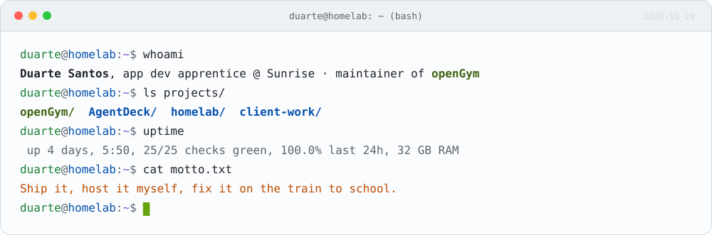
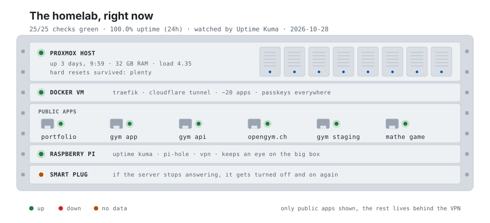
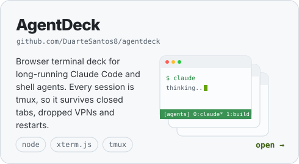
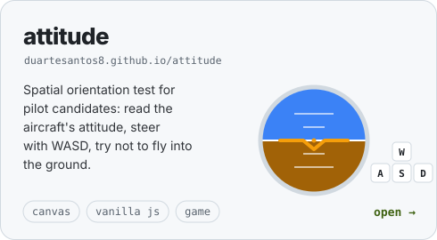
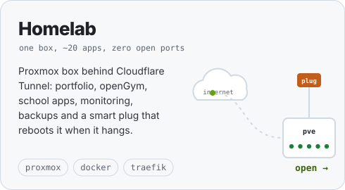
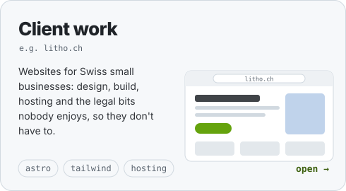
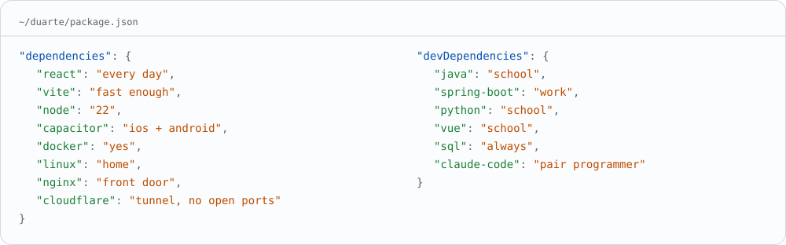

<picture>
  <source media="(prefers-color-scheme: dark)" srcset="assets/terminal-dark.svg">
  
</picture>

hey, I'm Duarte. I'm doing my apprenticeship as an application developer at **Sunrise** in Switzerland, and I maintain **[openGym](https://github.com/DuarteSantos8/openGym)**, an open-source workout tracker with 16k+ stars that runs on your phone, your wrist and your own server.

I like shipping things people actually use, and I host almost everything I build myself. Mostly on one small server at home, which sometimes needs to be turned off and on again. There is a smart plug for that.

**[duarte-santos.ch](https://duarte-santos.ch)** &nbsp;·&nbsp; **[openGym Discord](https://discord.gg/e62jY6fwVb)** &nbsp;·&nbsp; **[Buy me a coffee](https://buymeacoffee.com/duartesantos)**

 

<a href="https://github.com/DuarteSantos8/openGym">
  <picture>
    <source media="(prefers-color-scheme: dark)" srcset="assets/opengym-dark.svg">
    
  </picture>
</a>

Every gym tracker I tried wanted a subscription, an account or my training data on someone else's server, usually all three. So I wrote a small page for exactly one user (me). Now it's an **iPhone + Apple Watch app** in the App Store (every country), an **Android APK**, a **self-hostable** web app with passkey login and sync, thousands of animated exercises with a muscle map, imports from Strong, Hevy, FitNotes and Apple Health, an MCP server and an optional AI coach. I run it like a real project: releases every couple of weeks, a CLA, a Discord full of people telling me what's broken, and I'm still the first user of every release. **[opengym.ch](https://opengym.ch)**

 

<picture>
  <source media="(prefers-color-scheme: dark)" srcset="assets/rack-dark.svg">
  
</picture>

### Other things I've built

  <a href="https://github.com/DuarteSantos8/agentdeck"><picture><source media="(prefers-color-scheme: dark)" srcset="assets/tile-agentdeck-dark.svg"></picture></a>
  <a href="https://duartesantos8.github.io/attitude/"><picture><source media="(prefers-color-scheme: dark)" srcset="assets/tile-attitude-dark.svg"></picture></a>

  <a href="https://duarte-santos.ch"><picture><source media="(prefers-color-scheme: dark)" srcset="assets/tile-homelab-dark.svg"></picture></a>
  <a href="https://litho.ch"><picture><source media="(prefers-color-scheme: dark)" srcset="assets/tile-clients-dark.svg"></picture></a>

### What I mostly work with

<picture>
  <source media="(prefers-color-scheme: dark)" srcset="assets/stack-dark.svg">
  
</picture>

### My week, itemised

  <picture>
    <source media="(prefers-color-scheme: dark)" srcset="assets/receipt-dark.svg">
    
  </picture>

Zurich area, Switzerland &nbsp;·&nbsp; Applikationsentwickler EFZ + BM &nbsp;·&nbsp; every graphic here is a hand-rolled SVG, refreshed daily by <a href="scripts/generate.mjs">one Node script</a>

